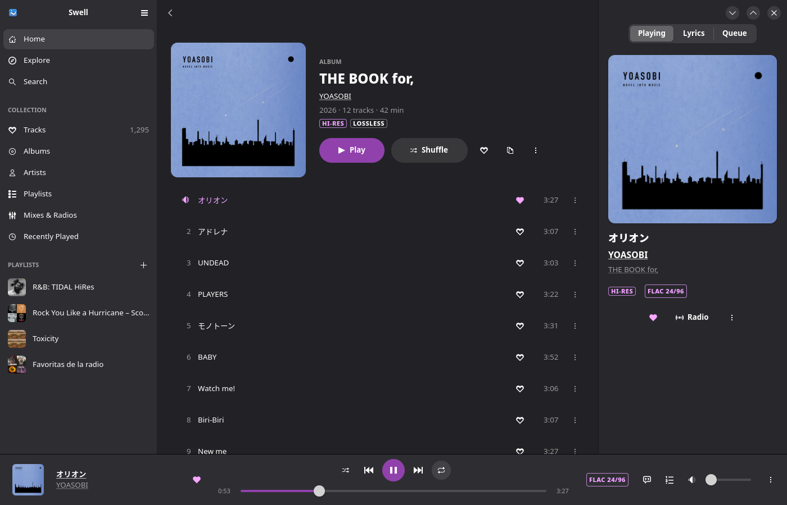
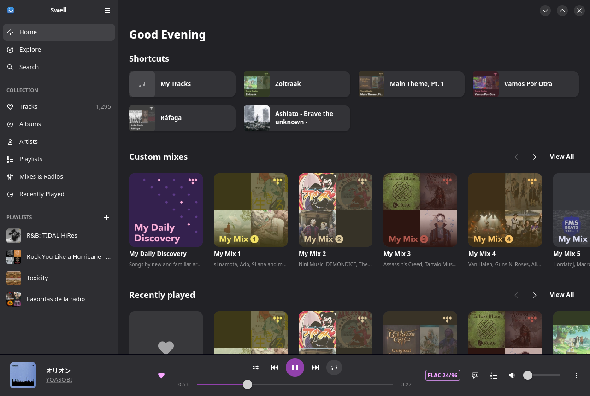
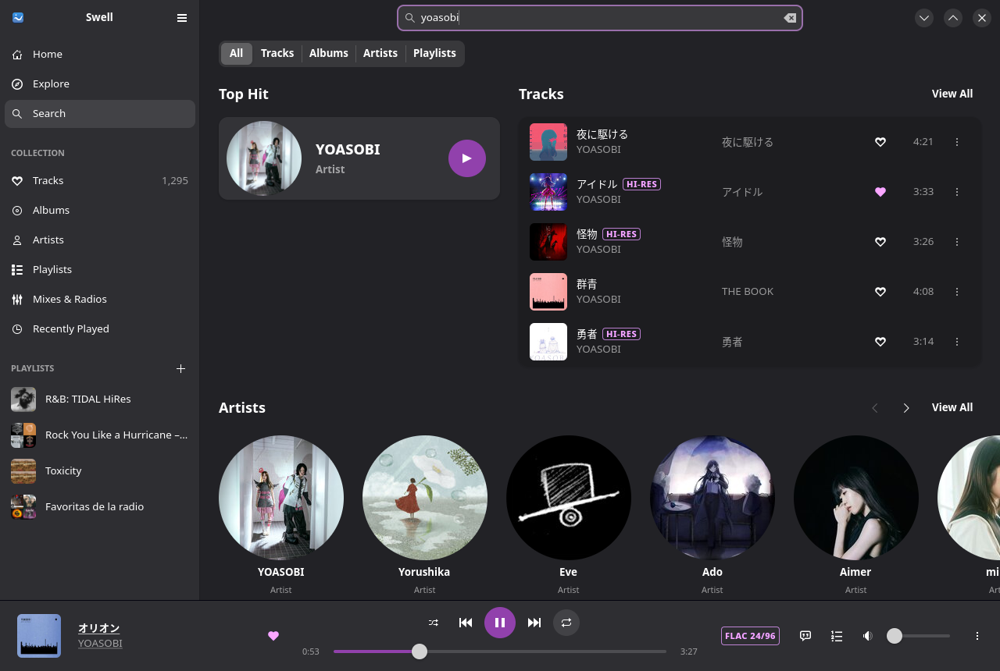
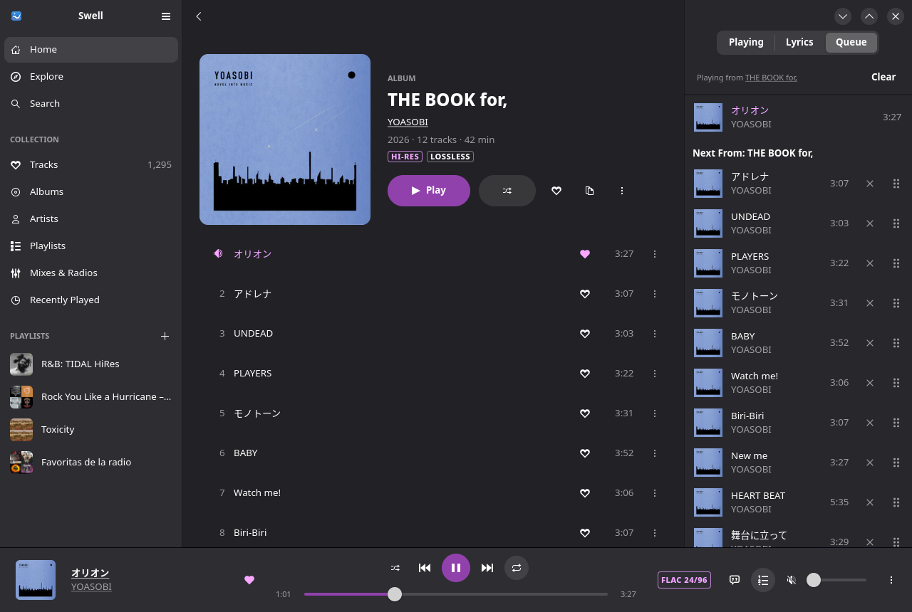
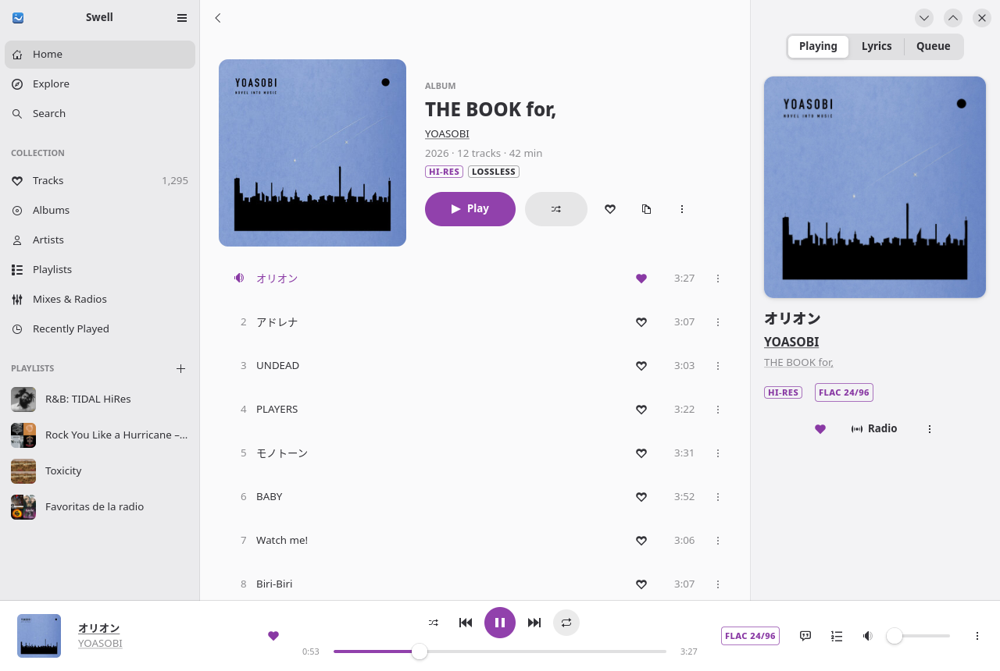
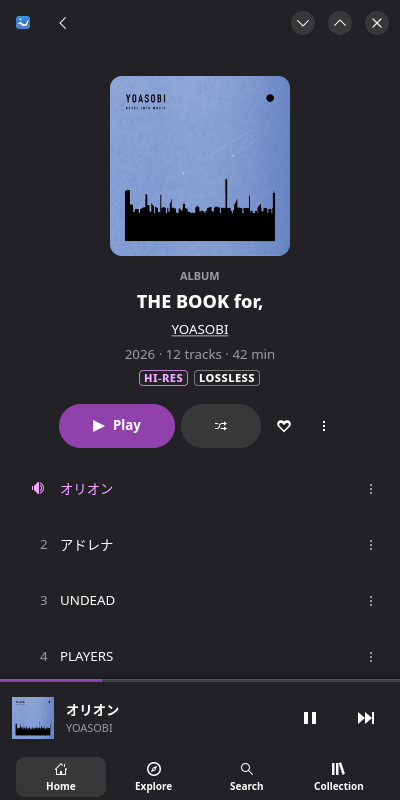

<div align="center">

[English](README.md) · [Español](README.es.md) · [Français](README.fr.md) · [Deutsch](README.de.md) · [Italiano](README.it.md) · [Português (Brasil)](README.pt_BR.md) · [Русский](README.ru.md) · **日本語** · [한국어](README.ko.md) · [简体中文](README.zh_CN.md) · [繁體中文](README.zh_TW.md)


# Swell

**高速なネイティブ TIDAL クライアント。ビットパーフェクトな Hi-Res 再生に対応。**

[](https://github.com/oxakromax/swell-player/actions/workflows/ci.yml)
[](https://github.com/oxakromax/swell-player/releases/latest)
[](COPYING)



</div>

Swell は Rust で書かれており、[gtk4-rs](https://gtk-rs.org)、
[libadwaita](https://gnome.pages.gitlab.gnome.org/libadwaita/)、
[GStreamer](https://gstreamer.freedesktop.org/) を使っています。
ライブラリはローカルキャッシュからすぐに開き、Hi-Res FLAC は加工されないままサウンドサーバーに届きます。
インターフェースはスマートフォンサイズのウィンドウからワイドなデスクトップまで適応し、
ほかのクライアントよりずっと少ないメモリで動作します
([計測結果](#計測結果))。

> [!NOTE]
> Swell は TIDAL と提携しておらず、TIDAL による承認やサポートも受けていません。
> TIDAL の非公式 API を使用しているため、予告なく変更される可能性があります。
> また、TIDAL の有料サブスクリプションが必要です。

## 目次

- [機能](#機能)
- [スクリーンショット](#スクリーンショット)
- [インストール](#インストール)
- [ログインと音質](#ログインと音質)
- [ビットパーフェクト再生](#ビットパーフェクト再生)
- [言語](#言語)
- [プライバシー](#プライバシー)
- [計測結果](#計測結果)
- [開発](#開発)
- [ライセンス](#ライセンス)

## 機能

**ブラウズ**
- ホーム：パーソナライズされた TIDAL フィード (ショートカット、ミックス、おすすめ、
  最近再生した曲)。スクロールに合わせて続きを読み込みます。探索：エディトリアルページ、
  ジャンル、ムード、年代。
- 入力しながら検索でき、フィルター (曲、アルバム、アーティスト、プレイリスト)、
  トップヒット、最近の検索、ページ送りに対応。TIDAL のリンクを貼り付けると、そのページが開きます。
- アルバム、アーティスト、プレイリスト、ミックス、ラジオのページ。クレジット、レビュー、
  バイオグラフィー、似たアーティスト、「すべて表示」ページを備えています。
- `tidal://` や `https://tidal.com/…` のリンクは Swell で開きます。

**コレクション**
- 数千曲のお気に入りの曲を仮想化して表示し、絞り込みと並べ替えも即座に反映。
  お気に入りのアルバム、アーティスト、プレイリスト、ミックス、最近再生した曲にも対応。
- あらゆるもの (曲、アルバム、アーティスト、プレイリスト、ミックス) にハートを付けられます。
  ライブラリ全体を 1 回のリクエストで取得します。
- プレイリストの作成、名前の変更、説明の編集、公開、削除。メニューから、
  またはサイドバーのプレイリストにドラッグして曲を追加でき、削除や並べ替えも、元に戻す操作つきで行えます。

**再生**
- Hi-Res Lossless (最大 24 ビット/192 kHz の FLAC)、[ビットパーフェクト](#ビットパーフェクト再生)。
- ギャップレス再生、オプションの ReplayGain (トラックまたはアルバム)、出力デバイスの選択。
- 本格的なキュー：次に再生、キューに追加、ジャンプ、削除、並べ替え、元に戻せる消去。
  シャッフル、全曲/1 曲リピート、履歴。
- ネットワークの切断やストリーム URL の期限切れがあっても、同じ位置から再開します。
- 曲に合わせて進み、クリックでシークできる同期歌詞。
- 起動時にキューと再生位置を復元。スリープタイマー、デスクトップ通知、再生中はシステムをスリープさせません。
- Linux では MPRIS に対応：メディアキー、デスクトップウィジェット、`playerctl` が使えます。

**インターフェース**
- システムのライト/ダークスタイルとアクセントカラーに従う libadwaita デザイン。
  3 つのレイアウトがあります：再生中パネルをドッキングしたワイド、標準、
  そしてボトムシートとミニプレーヤーを備えた狭い幅。
- 完全なキーボード操作 (Space、Ctrl+←/→、Ctrl+F、Ctrl+L、F6…。Ctrl+? ですべてのショートカットを一覧表示) と、
  すべてのコントロールにアクセシブルな名前を付けています。
- 英語とスペイン語。

## スクリーンショット

| ホーム | 検索 |
|---|---|
|  |  |
| **同期歌詞** | **ライトスタイル** |
|  |  |

<p align="center">
  
</p>

## インストール

各リリースのパッケージは
[Releases ページ](https://github.com/oxakromax/swell-player/releases)にあります。
Swell には GTK ≥ 4.18、libadwaita ≥ 1.7、そして base と good プラグインを含む GStreamer が必要です。
パッケージをインストールすると、これらも一緒に導入されます。

### Arch Linux (AUR)

AUR パッケージは準備中です。それまでは、このリポジトリにある同じ PKGBUILD をビルドしてください。

```bash
git clone https://github.com/oxakromax/swell-player.git
cd swell-player/packaging/aur/swell-player   # or swell-player-git
makepkg -si
```

AUR に公開されたら：`yay -S swell-player` (または `swell-player-git`)。

### Flatpak

Releases ページから `.flatpak` バンドルをダウンロードしてインストールしてください
(Flathub の GNOME ランタイムを使用します)。Flathub への掲載も予定しています。

```bash
flatpak remote-add --user --if-not-exists flathub https://dl.flathub.org/repo/flathub.flatpakrepo
flatpak install --user ./swell-player-*.flatpak
flatpak run io.github.oxakromax.SwellPlayer
```

### Debian と Ubuntu

Debian 13 (trixie)、Ubuntu 25.04 以降が必要です (GTK ≥ 4.18 と
libadwaita ≥ 1.7)。Releases ページから `.deb` をダウンロードしてください。

```bash
sudo apt install ./swell-player_*.deb
```

### Fedora

Releases ページから `.rpm` をダウンロードしてください。

```bash
sudo dnf install ./swell-player-*.rpm
```

### Windows

Releases ページからインストーラー (またはポータブル版の `.zip`) をダウンロードしてください。
ビルドにはまだコード署名がないため、SmartScreen が未認識のアプリとして警告することがあります。
その場合は **詳細情報 → 実行** を選んでください。

### macOS

Releases ページから `.dmg` をダウンロードし、Swell をアプリケーションフォルダにドラッグしてください。
アプリはまだ公証されていないため、初回は右クリック (または Control キーを押しながらクリック) して
**開く** を選んでください。macOS 15 以降では、一度開いてから
**システム設定 → プライバシーとセキュリティ → このまま開く** で許可します。
各リリースはアドホック署名のため、アップデート後に macOS が Swell のキーチェーン項目へのアクセスを
あらためて確認することがあります。その場合は **常に許可** を選んでください。
macOS では `tidal://` リンクはまだ Swell で開きません。また、Intel (x86_64) 版のディスクイメージは
ベストエフォートでの提供のため、リリースによっては含まれないことがあります。

Windows 版と macOS 版は Linux 版より新しく、MPRIS と下記のビットパーフェクトに関する説明は Linux 専用です。

### ソースから

Rust ≥ 1.96 (お使いのディストリビューションのものが古い場合は [rustup](https://rustup.rs))、
GTK ≥ 4.20 と libadwaita ≥ 1.8 (または `--no-default-features` を指定して GTK 4.18 と libadwaita 1.7)、
GStreamer ≥ 1.24、SQLite、GLib の `glib-compile-resources` が必要です。

<details>
<summary>ディストリビューションごとのビルド依存パッケージ</summary>

```bash
# Arch Linux
sudo pacman -S --needed rust pkgconf gtk4 libadwaita sqlite \
    gstreamer gst-plugins-base gst-plugins-good

# Debian 13 / Ubuntu: their rustc is too old, so install Rust with rustup,
# and build with `make CARGOFLAGS=--no-default-features` where GTK is
# older than 4.20 (Debian 13 ships 4.18)
sudo apt install build-essential pkg-config libgtk-4-dev libadwaita-1-dev \
    libsqlite3-dev libglib2.0-dev-bin libgstreamer1.0-dev \
    libgstreamer-plugins-base1.0-dev gstreamer1.0-plugins-good

# Fedora
sudo dnf install cargo pkgconf-pkg-config gtk4-devel libadwaita-devel sqlite-devel \
    glib2-devel gstreamer1-devel gstreamer1-plugins-base-devel gstreamer1-plugins-good
```

`gst-plugins-good` は、Hi-Res ストリームに使われる DASH デマルチプレクサー (`dashdemux2`) を提供します。

</details>

```bash
make                  # cargo build --release --locked
sudo make install     # binary, desktop entry, icon, metainfo under /usr/local
```

`make install PREFIX=/usr DESTDIR=…` はパッケージ作成用にインストール内容をステージングし、
`sudo make uninstall` で削除できます。アイコンと翻訳は埋め込まれているため、
バイナリは `target/release/swell-player` からそのまま実行することもできます。

## ログインと音質

TIDAL はサードパーティ製アプリが独自の OAuth クライアントを登録することを認めていません。
そのため Swell は、オープンソースの TIDAL クライアントと同じように、TIDAL 自身のアプリのいずれかとしてログインします。
どのログイン方法を選ぶかによってどのアプリになるかが決まり、それが音質の上限になります。

| ログイン方法 | 仕組み | 最高音質 |
|---|---|---|
| **ブラウザー** (推奨) | Swell がブラウザーで TIDAL のログインページを開きます。ログイン後、TIDAL は「Oops」と表示されたページに移動するので、そのページのアドレスを Swell にコピーして戻します。 | **Hi-Res Lossless**：最大 24 ビット/192 kHz の FLAC |
| **デバイスコード** | Swell が短いコードを表示します。任意のデバイスで `link.tidal.com` を開いて承認してください。 | **Lossless**：16 ビット/44.1 kHz の FLAC |

ストリーミング品質は **設定 → 再生** で選べます。
プレーヤーバーのフォーマットバッジには、実際に配信されている形式が表示されます。

## ビットパーフェクト再生

正規化をオフにして音量を 100 % にすると、Swell はストリームの形式を保ったまま PipeWire まで届けます。
24 ビット/96 kHz の曲は、24 ビット・96 kHz のまま届きます。
プレーヤーバーのフォーマットバッジをクリックするとポップオーバーが開き、
出力がビットパーフェクトかどうか、そうでない場合はその理由が表示されます。

サウンドカードに何が渡されるかは、その先で PipeWire が決めます。
デフォルトでは単一のレート (多くは 48 kHz) で動作し、それ以外はすべてリサンプリングされます。
PipeWire が各曲のレートに合わせられるようにするには、よく使われるレートを許可します。
たとえば `~/.config/pipewire/pipewire.conf.d/10-rates.conf` に次のように書きます。

```
context.properties = {
    default.clock.allowed-rates = [ 44100 48000 88200 96000 176400 192000 ]
}
```

その後、PipeWire を再起動します (`systemctl --user restart pipewire`)。
`pw-top` で、デバイスに届いている内容を確認できます。

## 言語

Swell は **英語** と **スペイン語** に対応しています。システムの言語に自動的に従い
(gettext と同様に `LANGUAGE`、`LC_ALL`、`LC_MESSAGES`、`LANG` を参照)、
**設定** で変更することもできます。TIDAL 自身のコンテンツ (エディトリアルの文章、ページタイトル) も
同じ言語で取得されるため、1 つの画面に 2 つの言語が混ざることはありません。

Swell をあなたの言語で使いたいですか？ [docs/translating.md](docs/translating.md) をご覧ください。

## プライバシー

- **トークン** はシステムのキーリング (Linux では Secret Service：GNOME キーリング、
  KWallet、KeePassXC…、Flatpak ではシークレットポータル) に保存され、
  平文でディスクに書き込まれることはありません。有効期限の少し前に更新され、
  ネットワークの問題でログアウトされることはありません。
- **コンピューターにキャッシュされるもの：** TIDAL の応答とライブラリ
  (`~/.cache/swell-player/library.sqlite3`)、アートワーク、再生した曲やこれから再生する曲の冒頭の数秒（`~/.cache/swell-player/audio/`、音声のみ、最大 512 MB）、設定、保存したキュー、最近の検索。
  設定からキャッシュを消去できます。ログアウトすると、トークン、キャッシュ、保存したキュー、
  検索履歴が削除されます。
- **テレメトリーなし。** Swell が接続するのは、表示や再生を求めたときの TIDAL のサーバーだけです。
  アナリティクス、クラッシュレポート、その他のサードパーティサービスは一切ありません。

## 計測結果

同じマシンで、Swell と [High Tide](https://github.com/Nokse22/high-tide) 1.6
(Python + PyGObject) を比較しました。どちらもヘッドレスの KWin セッション
(`kwin_wayland --virtual`、1280×860) で、保存済みのセッションを使用しています。
3 回の実行の中央値で、メモリは `/proc` から読み取っています (RssAnon はアプリ自身のヒープ、
RSS は共有ライブラリと、この環境ではどの GTK 4 アプリにもある約 250 MB の GPU ドライバーのマッピングも含みます)。
アイドル時の値は、何も再生していない状態で 10 秒間の平均です。

| | Swell | High Tide |
|---|---|---|
| ホームを表示：RssAnon / RSS | **61 MB / 360 MB** | 131 MB / 504 MB |
| お気に入りの 1,295 曲をキャッシュから表示 | 起動後 **0.42 秒** (TIDAL との同期完了は 0.50 秒) | — ¹ |
| … Swell のキャッシュなし | 最初の 100 曲は **0.59 秒**、すべて表示まで 1.2〜1.9 秒 | — ¹ |
| お気に入りビュー：RssAnon / RSS | 85 MB / 371 MB | — ¹ |
| アイドル時の CPU / メインスレッドのウェイクアップ | 約 0 % / 毎秒 1.1 回 | 約 0 % / 毎秒 0.1 回 |
| スレッド数 | 15 | 19 |
| Hi-Res の曲を選択 → 音が出るまで | **0.67 秒** (24 ビット/96 kHz、S24_32 の 96 kHz で PipeWire に到達) | — |

¹ High Tide はお気に入りをキャッシュせず、お気に入りリストを直接開く方法もありません。
テストハーネスを使った Swell の概念実証では、同じリストを表示するのに High Tide は 13.3 秒、
Swell は 0.3 秒でした。

マシン：Arch Linux、KDE Plasma 6 (Wayland)、GTK 4.24、libadwaita 1.10、
GStreamer 1.28、Rust 1.99、リリースビルド。

## 開発

```bash
cargo run --release
cargo test --release
cargo clippy --release --all-targets
```

[CONTRIBUTING.md](CONTRIBUTING.md) では、ビルド、テスト、デバッグ用の環境変数
(ページを開く、曲を再生する、ディスプレイなしでウィンドウを PNG に描画する)、
変更の送り方を説明しています。
[docs/architecture.md](docs/architecture.md) はコードの構成を、
[docs/features.md](docs/features.md) は機能の範囲を、
[docs/design.md](docs/design.md) はインターフェース仕様 (スペイン語) を説明しています。
リリースノートは [CHANGELOG.md](CHANGELOG.md) にあります。

セキュリティ上の問題を見つけましたか？ 非公開で報告してください：
[SECURITY.md](SECURITY.md) をご覧ください。

## ライセンス

Swell はフリーソフトウェアです。Free Software Foundation が発行する
GNU General Public License のバージョン 3、または (任意で) それ以降のバージョンの条件のもとで、
再配布および改変できます。[COPYING](COPYING) をご覧ください。

TIDAL は所有者の商標であり、ここでは Swell が何と連携するかを示すためだけに使用しています。
